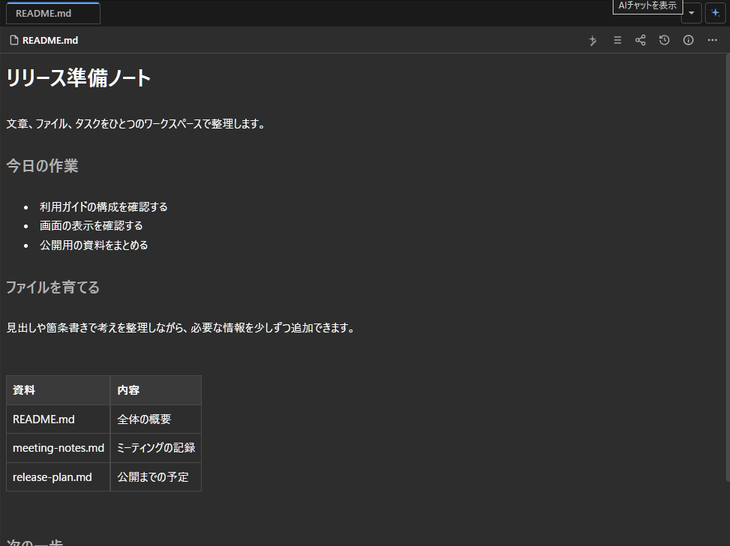
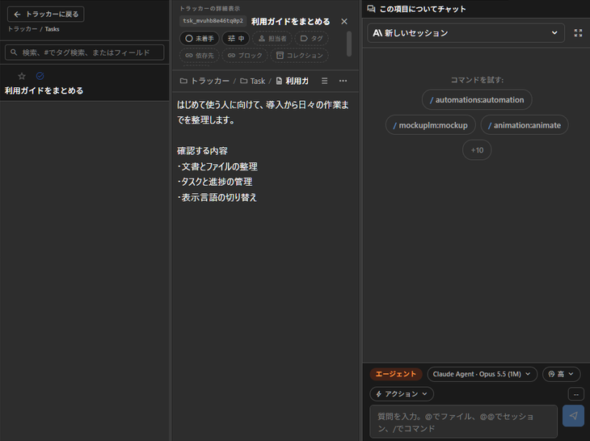
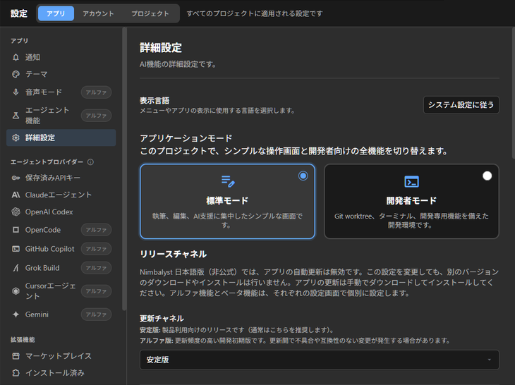

# Nimbalyst — Unofficial Japanese Edition

Nimbalyst is an open-source workspace that lets you switch between multiple AI agents, including Claude Code and Codex, from a single app. It also lets you manage the files, tasks, and progress involved in writing and app development together in one place.

An unofficial Japanese-language build of Nimbalyst. Japanese localization covers desktop menus, settings, file management, AI sessions, trackers, dialogs, and other parts of the user interface. The display language can be switched between Japanese and English.

This project is not affiliated with, endorsed by, or supported by Nimbalyst, Inc.

[日本語](README.md) · [Windows installation](docs/WINDOWS_JA_UNOFFICIAL.md#english) · [User guide](https://github.com/Meistertech-JP/nimbalyst-ja-unofficial/wiki/Home-English) · [Upstream Nimbalyst](https://github.com/nimbalyst/nimbalyst)

## Availability

The latest version, **v0.82.7-ja.1**, is an unsigned Windows x64 edition based on upstream v0.82.7 at `826adb4f93dbe86db35b76ce2502a3a33abe0489`. Download the NSIS installer, portable ZIP, corresponding source ZIP and SHA256SUMS.txt from the [release](https://github.com/Meistertech-JP/nimbalyst-ja-unofficial/releases/tag/v0.82.7-ja.1).

The source corresponding to these assets is tagged `v0.82.7-ja.1`. Use that release's tag and source ZIP rather than the continuously changing `main` branch. Earlier tags, releases and distributions, including [v0.82.4-ja.1](https://github.com/Meistertech-JP/nimbalyst-ja-unofficial/releases/tag/v0.82.4-ja.1), are retained. Features and fixes may differ from the latest official release.

The publication quality decision is **GO WITH KNOWN LIMITATIONS**. This does not mean a completely successful Windows full-suite run or verification of every live integration and display path. Read the [known limitations](docs/KNOWN_LIMITATIONS_v0.82.7-ja.1.md#english).

## Japanese interface

Screenshots from the Windows application. Documents and tasks use sample data.

### Document editing



### Tracker and AI sessions



### Display language and application settings



## Changes in this version

This edition incorporates upstream changes from v0.82.4 through v0.82.7, including Lexical 0.53 and colored Markdown text, migration from PGLite to SQLite, AI-session and SDK updates, session-history loading, weekly usage history, Windows Git/CLI fixes and Tracker local-number fixes. It also integrates fixes originating from upstream issue #1889 and adds Japanese display for new UI. The [release notes](RELEASE_NOTES_v0.82.7-ja.1.md) distinguish incorporated changes from behavior exercised during verification.

**Team recovery requires the updated sync server.** Other editing clients must also support recovery. Production-organization recovery and the complete procedure across independent clients have not been verified. Check server compatibility and the intended recovery target before attempting recovery of an existing organization.

## Language and data

Select System, English, or Japanese in display-language settings. This is independent of the agent response language. User documents and external service responses are not automatically translated. Some Tracker names and statuses remain in English.

Shared resources contain 27 namespaces and 15,321 keys in each language, with zero key differences, empty Japanese translations or interpolation mismatches. Electron native menus are also covered. Resource consistency does not guarantee translation of every screen or dynamic reference path.

The Windows application ID is `jp.meistertech.nimbalyst.ja.unofficial`; the default profile is `%APPDATA%\Nimbalyst 日本語版（非公式）`. Official settings are not moved or deleted. Running alongside the official application is unsupported. This edition does not claim the default `nimbalyst://` handler; authentication uses an instance-specific, nonce-protected localhost callback. Open authentication email on the same Windows PC.

Updates are manual through this repository's Releases. Official automatic updates and manual update checks are disabled. Uninstallation is configured to retain user data.

## Windows distribution and validation

The [verification record](https://github.com/Meistertech-JP/nimbalyst-ja-unofficial/wiki/Testing-and-Verification-English) distinguishes native observations, automated tests and unverified areas for each version. Observations from earlier binaries are not treated as re-execution on a new distribution. Coverage does not extend to every screen, DPI setting or authentication path.

Release assets are an unsigned Windows x64 NSIS installer, portable ZIP, corresponding source ZIP, and SHA256SUMS.txt. Do not disable warnings or protections; check the source, version, and SHA-256. Matching hashes are not publisher signatures or safety guarantees.

Repeated natural exits of outer shell/CLI processes can retain terminal resources and memory until the app closes, in both upstream and this edition. Twenty natural exits increased Main-process memory by about 156 MiB in each comparison. This is not an increase for every command inside a persistent shell or evidence of an unlimited linear growth rate. If memory increases, save work, quit normally and restart. The root cleanup issue remains unfixed.

Large editable documents can cause elevated CPU use, and local-wiki startup context may be delayed or omitted under heavy load. The Windows full suite did not finish normally because of same-process loopback stalls and other host-sensitive failures; separate-process major API probes passed both editions. This edition's Linux unit suite recorded 19,754 PASS / 0 FAIL / 30 SKIP; this is not a Linux product distribution or runtime guarantee. See the [bilingual limitations](docs/KNOWN_LIMITATIONS_v0.82.7-ja.1.md#english).

Google sign-in, special recovery paths, server-side session revocation, cross-user NTFS effective access, external screen readers and complete dynamic-translation coverage remain unverified. EPERM during Windows symlink-fixture setup leaves untested behavior; Linux success is recorded separately. See [limitations](https://github.com/Meistertech-JP/nimbalyst-ja-unofficial/wiki/Compatibility-and-Limitations-English).

Features using shared built-in Tracker types require a compatible sync server. Compatibility with older servers and clients has not been verified. After using this edition, an older version may not be able to read the saved external-session cursor format. Downgrading and recovery have not been verified.

## Build from source

Use Node.js 24 or later, the repository's pnpm 12.9.1, and Windows native build tools.

```powershell
corepack pnpm install --frozen-lockfile
corepack pnpm --filter @nimbalyst/i18n run build
corepack pnpm run build:workspace-deps
corepack pnpm --filter @nimbalyst/memory-engine run build
corepack pnpm --filter @nimbalyst/tracker-builtins run build
corepack pnpm --filter @nimbalyst/collab-bundle run build
corepack pnpm --filter @nimbalyst/runtime run build
$env:ALLOW_UNSIGNED_WINDOWS_BUILD = 'true'
$env:CSC_IDENTITY_AUTO_DISCOVERY = 'false'
corepack pnpm --dir packages/electron run build:win --publish never
```

Create a ZIP from the same completed payload in `packages/electron/release/win-unpacked`:

```powershell
corepack pnpm --dir packages/electron exec electron-builder --prepackaged release/win-unpacked --win zip --x64 --publish never
```

Successful generation does not establish successful startup, authentication, or upgrade. An unsigned build requires no signing credentials. Run typecheck with `corepack pnpm run typecheck`.

## License

MIT License. The original `Copyright (c) 2024-2026 Nimbalyst Inc.` and license text are retained. Third-party software remains subject to its own licenses. Inventories and notices are included under `packages/electron/resources/generated` in source and `resources/legal` in Windows packages.
