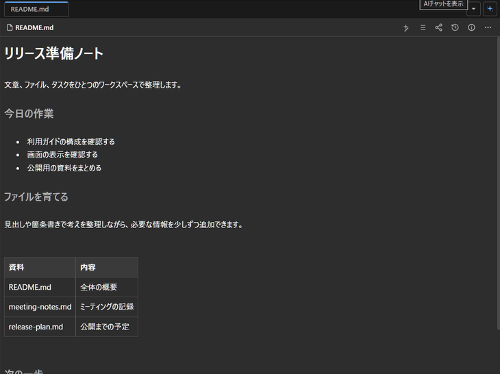
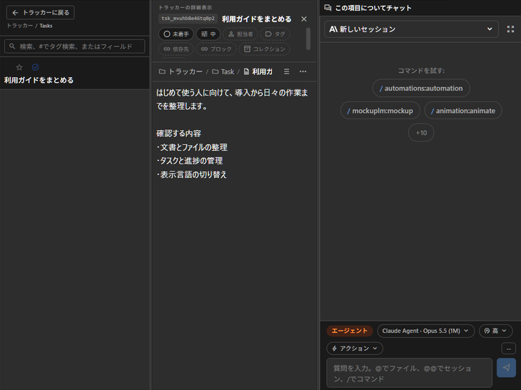
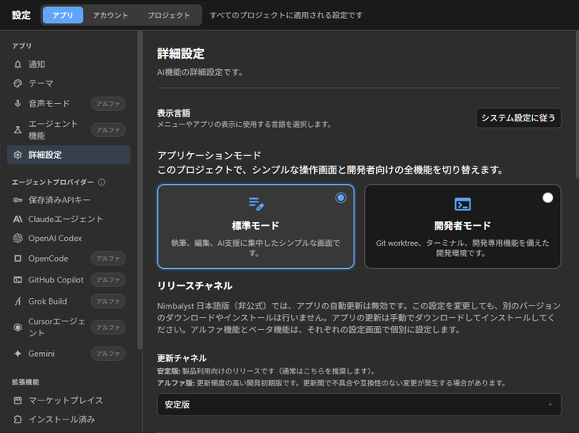

# Nimbalyst — Unofficial Japanese Edition

Nimbalyst is an open-source workspace that lets you switch between multiple AI agents, including Claude Code and Codex, from a single app. It also lets you manage the files, tasks, and progress involved in writing and app development together in one place.

This unofficial edition adds Japanese text to desktop menus, settings, files, AI sessions and other parts of the interface. It is not affiliated with, endorsed by, or supported by Nimbalyst, Inc.

[日本語](README.md) · [User guide](https://github.com/Meistertech-JP/nimbalyst-ja-unofficial/wiki/Home-English) · [Upstream Nimbalyst](https://github.com/nimbalyst/nimbalyst)

## Download

The latest edition is **v0.84.0-ja.1 for Windows x64**.

- [Installer](https://github.com/Meistertech-JP/nimbalyst-ja-unofficial/releases/download/v0.84.0-ja.1/nimbalyst-0.84.0-ja.1-windows-x64-setup.exe): use Windows app-list entries and shortcuts.
- [Portable ZIP](https://github.com/Meistertech-JP/nimbalyst-ja-unofficial/releases/download/v0.84.0-ja.1/nimbalyst-0.84.0-ja.1-windows-x64-portable.zip): extract the complete application and run it without an installer.

The [Release page](https://github.com/Meistertech-JP/nimbalyst-ja-unofficial/releases/tag/v0.84.0-ja.1) also provides matching source and SHA256SUMS.txt. Read the [Windows installation guide](docs/WINDOWS_JA_UNOFFICIAL.md#english) before running the unsigned files.

## What changes in this version?

This edition brings upstream v0.83.0 and v0.84.0 changes to users of v0.82.8-ja.1.

- **Keep related AI conversations together.** In Agent Mode, choose New Workstream… to create a named folder; use Move to Workstream… to organize existing conversations. Group the conversations for a piece of work in one place without treating that folder as an agent management relationship.
- **Deliver follow-up instructions together.** Messages sent while an agent is busy enter a queue. Ordinary messages with the same document context are delivered together in the next turn, with their authors identified. Commands and messages about different documents remain separate; the Claude Code CLI path processes queued messages individually.
- **Change branches in the Git panel.** Click the current branch name above the Git panel’s Log to choose an existing branch, check out one that exists only on the remote, or create a new branch. You no longer need to leave that panel for these branch operations.
- **Review a folder's changes as a commit proposal.** Ask an agent for a proposal covering a folder. Its changed files appear for review, where you can select folders or individual files; check the file list and diff before approving the commit.
- **Keep Markdown structure intact.** Fixes preserve nested lists beneath numbered items when saving. They also address broken Markdown caused by agent edits near comments on part of bold text or inline code.
- **Share a local Wiki for team review.** The CLI command `nim wiki publish` publishes changes in one direction from your local Wiki to a team project and supports review with a Commenter role. A compatible sync server and appropriate access are required. It is not a public website or an update to this project's GitHub Wiki.

See [Getting Started](https://github.com/Meistertech-JP/nimbalyst-ja-unofficial/wiki/Getting-Started-English) for entry points and the [release notes](RELEASE_NOTES_v0.84.0-ja.1.en.md) for details. These are integrated upstream features, not a claim that every live integration has been verified.

### Changes specific to the Japanese edition

New interface text has been translated. This edition also fixes settings handling when a profile location is explicitly supplied and Windows file/path handling. It uses settings and data separate from the official app, with manual updates from this repository.

## Get started

1. Download a distribution, compare its SHA-256 and follow the installation guide. Extract every file in the ZIP, not just the EXE.
2. Follow the welcome screen, then open the tutorial or a working folder. Using an agent also requires the relevant service's authentication and account terms.
3. To change the interface language, open Settings → App → Advanced → Display language and choose Japanese, English or System.

Changing the display language does not translate your documents or AI responses. Signing in to Nimbalyst is separate from authenticating Claude, Codex or another agent. See [Account and Authentication](https://github.com/Meistertech-JP/nimbalyst-ja-unofficial/wiki/Account-and-Authentication-English).

## Important before use

- **Upstream v0.84.0 is a prerelease.** This edition is a regular GitHub Release and Latest, not an upstream-certified or stability-guaranteed build.
- **The Windows full test run has 108 unresolved failures.** This is not an all-tests-passing release. Read the [known limitations](docs/KNOWN_LIMITATIONS_v0.84.0-ja.1.md#english) for scope and impact.
- **High CPU use with long Markdown documents remains unresolved.**
- **Files are unsigned and updates are manual.** Official automatic updates and update checks are disabled. Check provenance and checksums without disabling security protections.
- **Team features need a compatible server.** Live sync/collaboration connections and compatibility with older servers remain unverified.
- Running alongside the official app is unsupported. Save your work and back up important documents before updating. Downgrades are unverified.

Detailed results and untested areas are in [Testing and Verification](https://github.com/Meistertech-JP/nimbalyst-ja-unofficial/wiki/Testing-and-Verification-English). Successful Linux CI does not replace Windows full-suite success.

## Japanese interface

Windows screenshots from v0.82.4-ja.1, with sample documents and tasks. They illustrate the interface; details may differ in the latest edition.

### Document editing

### Tracker and AI sessions

### Display language and application settings

## Guides and source

- [Windows installation, updating and removal](docs/WINDOWS_JA_UNOFFICIAL.md#english)
- [Known limitations](docs/KNOWN_LIMITATIONS_v0.84.0-ja.1.md#english)
- [Building from source](https://github.com/Meistertech-JP/nimbalyst-ja-unofficial/wiki/Building-from-Source-English)
- [Previous v0.82.8-ja.1 and older distributions](https://github.com/Meistertech-JP/nimbalyst-ja-unofficial/releases)

## License

[MIT License](LICENSE). Upstream copyright notices and license text are retained. Bundled third-party software is covered by its own LICENSE and NOTICE files.
