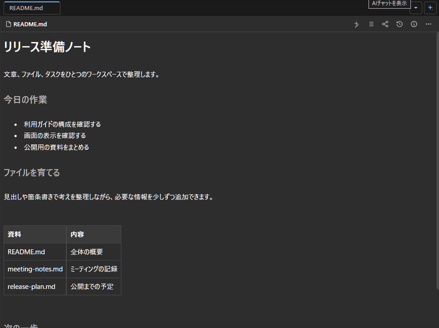
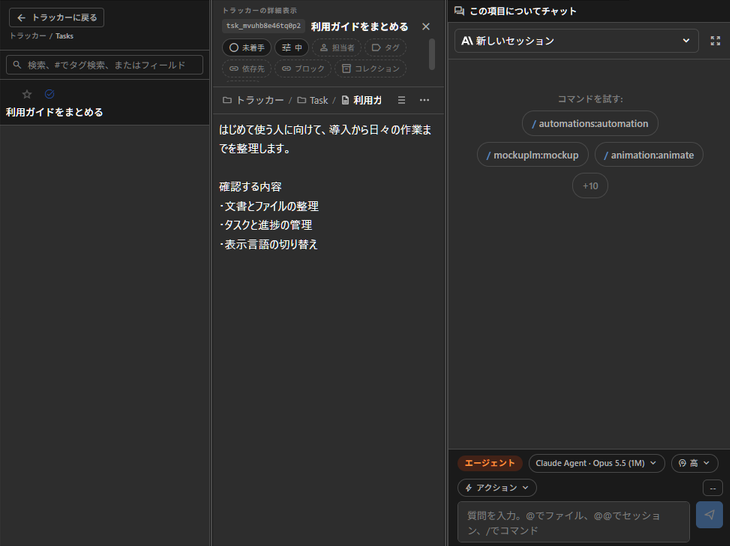
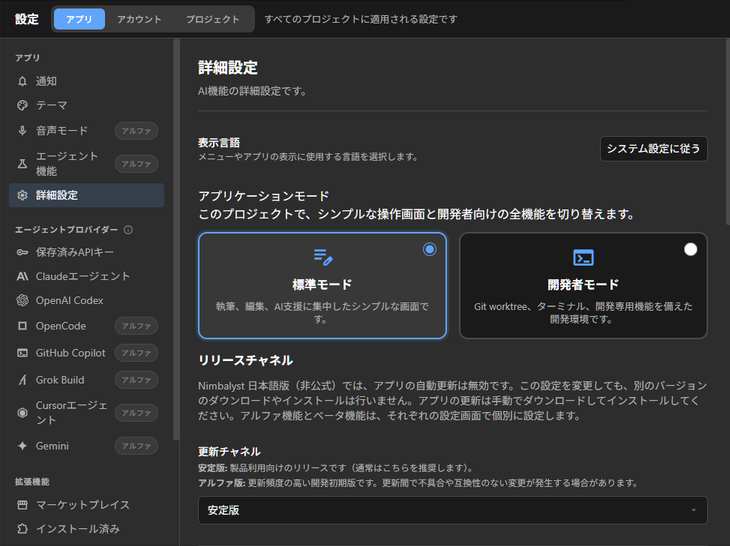

# Nimbalyst — Unofficial Japanese Edition

Nimbalyst is an open-source workspace that lets you switch between multiple AI agents, including Claude Code and Codex, from a single app. It also lets you manage the files, tasks, and progress involved in writing and app development together in one place.

An unofficial Japanese-language build of Nimbalyst, based on version 0.82.4. Japanese localization covers desktop menus, settings, file management, AI sessions, trackers, dialogs, and other parts of the user interface. The display language can be switched between Japanese and English.

This project is not affiliated with, endorsed by, or supported by Nimbalyst, Inc.

[日本語](README.md) · [Windows installation](docs/WINDOWS_JA_UNOFFICIAL.md#english) · [User guide](https://github.com/Meistertech-JP/nimbalyst-ja-unofficial/wiki/Home-English) · [Upstream Nimbalyst](https://github.com/nimbalyst/nimbalyst)

## Availability

The latest version, v0.82.4-ja.1, is an unsigned Windows x64 edition. Download the NSIS installer, portable ZIP, matching source and SHA256SUMS.txt from the [release](https://github.com/Meistertech-JP/nimbalyst-ja-unofficial/releases/tag/v0.82.4-ja.1).

The source corresponding to these assets is tagged `v0.82.4-ja.1`. Use that release's tag and source ZIP rather than the continuously changing `main` branch. The [previous v0.82.3-ja.2 release](https://github.com/Meistertech-JP/nimbalyst-ja-unofficial/releases/tag/v0.82.3-ja.2), its tag and distributions are retained.

This edition is based on upstream v0.82.4 at `031a6e6de0b7817bbdcd16e6e5e758e45dfdcdc7`. Features and fixes may differ from the latest official release.

## Japanese interface

Screenshots from the Windows application. Documents and tasks use sample data.

### Document editing



### Tracker and AI sessions



### Display language and application settings



## Changes in this version

This edition incorporates upstream v0.82.4 changes to file operations, search, image viewing, AI-session questions and shared pages. See the [release notes](RELEASE_NOTES_v0.82.4-ja.1.md) for changes and verification scope.

**Team recovery requires the updated sync server.** Other editing clients must also support recovery. Production-organization recovery and the complete procedure across independent clients have not been verified. Check server compatibility and the intended recovery target before attempting recovery of an existing organization.

## Language and data

Select System, English, or Japanese in display-language settings. This is independent of the agent response language. User documents and external service responses are not automatically translated. Some Tracker names and statuses remain in English.

The Windows application ID is `jp.meistertech.nimbalyst.ja.unofficial`; the default profile is `%APPDATA%\Nimbalyst 日本語版（非公式）`. Official settings are not moved or deleted. Running alongside the official application is unsupported. This edition does not claim the default `nimbalyst://` handler; authentication uses an instance-specific, nonce-protected localhost callback. Open authentication email on the same Windows PC.

Updates are manual through this repository's Releases. Official automatic updates and manual update checks are disabled. Uninstallation is configured to retain user data.

## Windows distribution and validation

The [verification record](https://github.com/Meistertech-JP/nimbalyst-ja-unofficial/wiki/Testing-and-Verification-English) distinguishes native observations, automated tests and unverified areas for each version. Observations from earlier binaries are not treated as re-execution on a new distribution. Coverage does not extend to every screen, DPI setting or authentication path.

Release assets are an unsigned Windows x64 NSIS installer, portable ZIP, corresponding source ZIP, and SHA256SUMS.txt. Do not disable warnings or protections; check the source, version, and SHA-256. Matching hashes are not publisher signatures or safety guarantees.

Google sign-in, special recovery paths, server-side session revocation, cross-user NTFS effective access, external screen readers and complete dynamic-translation coverage remain unverified. EPERM during Windows symlink-fixture setup leaves untested behavior; Linux success is recorded separately. See [limitations](https://github.com/Meistertech-JP/nimbalyst-ja-unofficial/wiki/Compatibility-and-Limitations-English).

Features using shared built-in Tracker types require a compatible sync server. Compatibility with older servers and clients has not been verified. After using this edition, an older version may not be able to read the saved external-session cursor format. Downgrading and recovery have not been verified.

## Build from source

Use Node.js 24 or later, the repository's pnpm 12.9.1, and Windows native build tools.

```powershell
corepack pnpm install --frozen-lockfile
corepack pnpm --filter @nimbalyst/i18n run build
corepack pnpm run build:workspace-deps
corepack pnpm --filter @nimbalyst/memory-engine run build
corepack pnpm --filter @nimbalyst/tracker-builtins run build
corepack pnpm --filter @nimbalyst/collab-bundle run build
corepack pnpm --filter @nimbalyst/runtime run build
$env:ALLOW_UNSIGNED_WINDOWS_BUILD = 'true'
$env:CSC_IDENTITY_AUTO_DISCOVERY = 'false'
corepack pnpm --dir packages/electron run build:win --publish never
```

Create a ZIP from the same completed payload in `packages/electron/release/win-unpacked`:

```powershell
corepack pnpm --dir packages/electron exec electron-builder --prepackaged release/win-unpacked --win zip --x64 --publish never
```

Successful generation does not establish successful startup, authentication, or upgrade. An unsigned build requires no signing credentials. Run typecheck with `corepack pnpm run typecheck`.

## License

MIT License. The original `Copyright (c) 2024-2026 Nimbalyst Inc.` and license text are retained. Third-party software remains subject to its own licenses. Inventories and notices are included under `packages/electron/resources/generated` in source and `resources/legal` in Windows packages.
