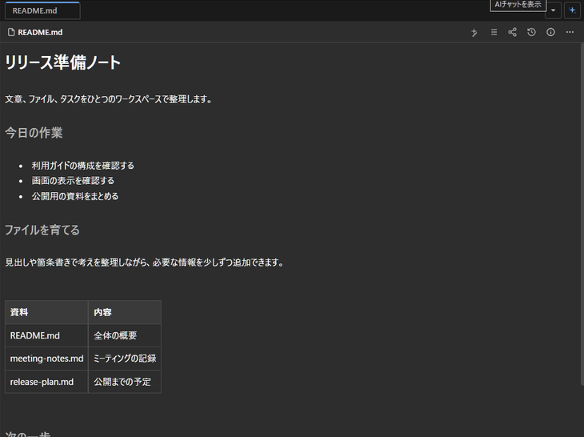
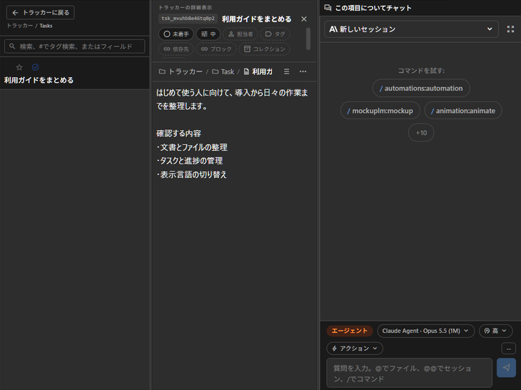
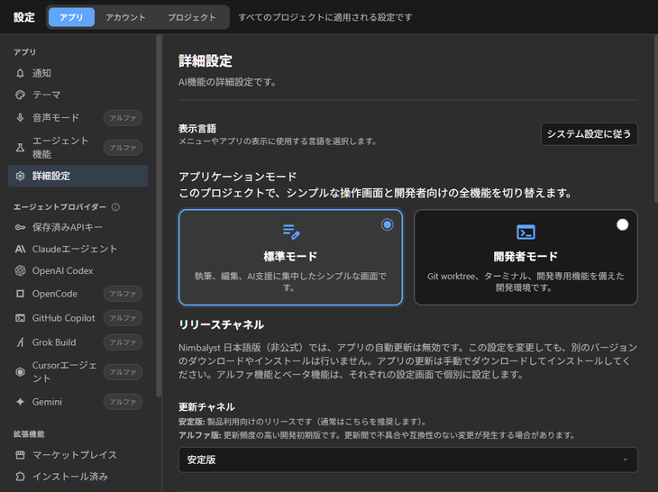

# Nimbalyst 日本語版（非公式）

Nimbalystは、Claude CodeやCodexなど、複数のAIエージェントを一つのアプリから使い分けられる、オープンソースの作業環境です。文章の執筆やアプリ開発に必要なファイル、タスク、進捗状況も、ひとつの画面でまとめて管理できます。

Nimbalystのデスクトップアプリのユーザーインターフェースを日本語化した非公式版です。メニュー、設定、ファイル管理、AIセッション、トラッカー、ダイアログなどに日本語表示を追加しています。表示言語は日本語と英語から選択できます。

本プロジェクトはNimbalyst, Inc.の公式製品ではなく、同社による開発・サポート・承認を受けたものではありません。

[English](README.en.md) · [Windows導入手順](docs/WINDOWS_JA_UNOFFICIAL.md) · [利用ガイド](https://github.com/Meistertech-JP/nimbalyst-ja-unofficial/wiki) · [本家Nimbalyst](https://github.com/nimbalyst/nimbalyst)

## 提供状況

最新版 **v0.84.0-ja.1** は本家v0.84.0（固定コミット `dc5a0ef938cf495a0667d797f871d09d0c44246f`）を基準とする、Windows x64向けの非公式・未署名版です。[正式Release](https://github.com/Meistertech-JP/nimbalyst-ja-unofficial/releases/tag/v0.84.0-ja.1)からNSISインストーラー、Portable ZIP、対応Source ZIPとSHA256SUMS.txtを取得できます。配布ソースは対象タグを使用してください。[前版v0.82.8-ja.1](https://github.com/Meistertech-JP/nimbalyst-ja-unofficial/releases/tag/v0.82.8-ja.1)と過去のタグ・Release・配布物は保持しています。

本家v0.84.0はGitHub上でPrereleaseです。日本語版はGitHub上の通常Release・Latestとして配布しますが、本家による安定性保証や公式認定ではありません。`v0.84.0-ja.1` はSemVer上ではプレリリース識別子を含み、GitHubの分類はその意味を変更しません。

品質判定は **GO WITH KNOWN LIMITATIONS** です。[リリースノート](RELEASE_NOTES_v0.84.0-ja.1.md)と[既知制限](docs/KNOWN_LIMITATIONS_v0.84.0-ja.1.md)を確認してください。

## 日本語の画面

画面構成を示すv0.82.4-ja.1のWindows実画面です。文書とタスクはサンプルです。最新版とは表示・操作が一部異なる場合があります。

### 文書の編集



### トラッカーとAIセッション



### 表示言語とアプリケーション設定



## この版の変更

本家v0.82.8以降のv0.83.0・v0.84.0を取り込みました。Claude Fable 5.2選択、キューの一括配送、Gitパネルのブランチ切替、Workstreams、フォルダー単位のコミット提案、Markdownネストリスト保存、ファイルツリー省略件数表示、Wiki公開、SQLiteバックアップ・ツール出力保持処理などを含みます。日本語版では新しいUIの翻訳、明示的な隔離プロファイルの保存先境界、Windowsのファイル・パス処理を修正しました。統合した機能すべての実接続を確認したわけではありません。

**チーム復旧には更新された同期サーバーが必要です。** 他の編集クライアントにも対応版が必要です。本番組織の復旧や独立クライアント間の完全な復旧手順は未検証です。既存組織の復旧を試す前に、サーバーの対応状況と復旧対象を確認してください。

## 表示言語とデータ

設定の表示言語でSystem、English、日本語を選択します。エージェントの回答言語とは別の設定です。ユーザー文書や外部サービスの応答を自動翻訳しません。Trackerの一部の名前や状態には英語が残ります。

共有翻訳資源は27名前空間、英語・日本語各15,557キーです。キー差と補間変数差は0です。日本語側に1件ある単一空白は、英語側にも同じ値を持つ書式用区切り `common.local_wiki.export.note_separator` です。静的ソース監査では11,523件のリテラル参照に欠落はありませんでした。一方、489件の動的呼出し候補があり、211件は名前空間scopeを静的に確定できていません。これは欠落キー数ではありませんが、全動的参照の実行時確認も完了していません。前版v0.82.8-ja.1の翻訳資源は各15,401キーです。

WindowsアプリIDは `jp.meistertech.nimbalyst.ja.unofficial`、既定ユーザーデータは `%APPDATA%\Nimbalyst 日本語版（非公式）` です。公式版の設定を移動・削除しません。公式版との同時利用はサポートしません。本版は `nimbalyst://` の既定ハンドラーを取得せず、認証にはインスタンス固有のnonce付きlocalhost callbackを使用します。認証メールは同じWindows PCで開いてください。

更新は本リポジトリのReleasesから手動で行います。公式版の自動更新と手動更新確認は無効です。アンインストールはユーザーデータを保持する構成です。

## Windows配布と検証範囲

版ごとの実機操作、自動テスト、未検証事項は[検証記録](https://github.com/Meistertech-JP/nimbalyst-ja-unofficial/wiki/Testing-and-Verification)に区別して記載しています。以前のバイナリの成功を、新しい配布物での再実行結果とは扱いません。全画面・全DPI・全認証経路の保証はありません。

配布対象は未署名Windows x64 NSIS、ポータブルZIP、対応するソースZIPとSHA256SUMS.txtです。警告や保護機能を無効にせず、取得元・バージョン・SHA-256を確認してください。ハッシュ一致は電子署名や安全性の保証ではありません。

旧版ではshell／CLIの自然終了後に端末資源が残る現象を観測しました。前版v0.82.8-ja.1の単一ホストでは終了3秒後に子shellを観測しませんでしたが、一般的な解消を証明するものではありません。資源の増加が見られる場合は作業を保存し、通常終了して再起動してください。

製品検証基準は `29fdcc216f354cd1031dc9ef36672a5399bd6775`（製品入力 `a7f82db90`、差は単体試験1ファイル）です。Windows全Vitestは20,182 PASS／108 FAIL／37 SKIP、exit 1で完走しました。108件は継続未解決です。R22にも同じパス・テスト名の失敗が99件ありますが、同名は原因同一・無害の証明ではなく、全108件を新規の重大回帰とも全環境依存とも断定しません。39 workspace型検査と7容量上限はPASS。Linuxの20,296 PASS／0 FAIL／31 SKIP、Android Build SUCCESS（署名job SKIP）、iOS 522 PASS／0 FAIL／6 SKIPはWindows全成功とは別の結果です。

通常Windows製品07dのwin-unpacked・完全展開Portable・NSISで起動、日英切替、正常終了と再起動後の言語保持を確認しました。NSIS新規導入、前版v0.82.8-ja.1からのNSIS/Portable更新では、専用環境の設定・合成文書hash・Tracker表示の保持を確認しました。全実ユーザーデータ・全DBフィールドの移行保証ではありません。NSISの通常アンインストール後も専用ユーザーデータを保持しました。Start Menu登録は隔離した環境での限定確認です。旧版へのダウングレードは未検証です。

最終Windows製品07dの通常win-unpackedと専用プロファイルで、本番メール認証、暗号化認証ファイルの生成、正常終了・再起動後の復元、通常サインアウト、認証ファイル削除、次回起動後の未認証保持を確認しました。NSIS専用プロファイル・別Portableでの新規認証、Google認証、サービス側セッション失効、特殊復旧は未確認です。Node資格情報ファイル試験とは別のElectronアカウント認証の観測です。

長文Markdownの高CPU負荷は未解決です。高負荷Wiki文脈処理、Windows端末資源残留の一般的解消、動的翻訳全経路、全DPI・外部スクリーンリーダー条件は確認していません。Windows symlink fixture作成EPERMは拒否処理そのものの未検証範囲を残します。実マイク・実音声認識API、実同期・共同編集サーバー、実組織、旧新サーバー間相互運用は未検証です。Wiki公開・チーム権限等には対応サーバーが必要です。これらの未確認事項を確認済みの不具合・脆弱性と同一視しないでください。

Google認証、特殊な復旧経路、サーバー側のセッション失効、別ユーザーのNTFS実効アクセス、外部スクリーンリーダー、動的翻訳参照の全経路は未検証です。Windowsのsymlink fixture準備でEPERMとなる試験には未検証範囲があり、Linuxでの成功と区別します。[制限事項](https://github.com/Meistertech-JP/nimbalyst-ja-unofficial/wiki/Compatibility-and-Limitations)を参照してください。

共有Trackerの組み込み型を使用する機能には対応する同期サーバーが必要です。旧サーバー・旧クライアントとの互換性は未検証です。また、本版使用後に旧版へ戻すと、保存された外部セッションのカーソル形式を旧版が読み取れない場合があります。ダウングレードと復旧は未検証です。

## ソースからのビルド

Node.js 24以降、リポジトリ指定のpnpm 12.9.1、Windowsネイティブビルドツールを使用します。

```powershell
corepack pnpm install --frozen-lockfile
corepack pnpm --filter @nimbalyst/i18n run build
corepack pnpm run build:workspace-deps
corepack pnpm --filter @nimbalyst/memory-engine run build
corepack pnpm --filter @nimbalyst/tracker-builtins run build
corepack pnpm --filter @nimbalyst/collab-bundle run build
corepack pnpm --filter @nimbalyst/runtime run build
$env:ALLOW_UNSIGNED_WINDOWS_BUILD = 'true'
$env:CSC_IDENTITY_AUTO_DISCOVERY = 'false'
corepack pnpm --dir packages/electron run build:win --publish never
```

完成した `packages/electron/release/win-unpacked` から同じペイロードのZIPを生成できます。

```powershell
corepack pnpm --dir packages/electron exec electron-builder --prepackaged release/win-unpacked --win zip --x64 --publish never
```

生成成功は実起動・認証・更新成功の保証ではありません。未署名ビルドに署名資格情報は不要です。型検査は `corepack pnpm run typecheck` で実行します。

## ライセンス

MIT Licenseです。元の `Copyright (c) 2024-2026 Nimbalyst Inc.` とライセンス本文を保持しています。同梱第三者ソフトウェアには各ライセンスが適用されます。ソース内の `packages/electron/resources/generated` と配布物の `resources/legal` に一覧・NOTICEを同梱します。
