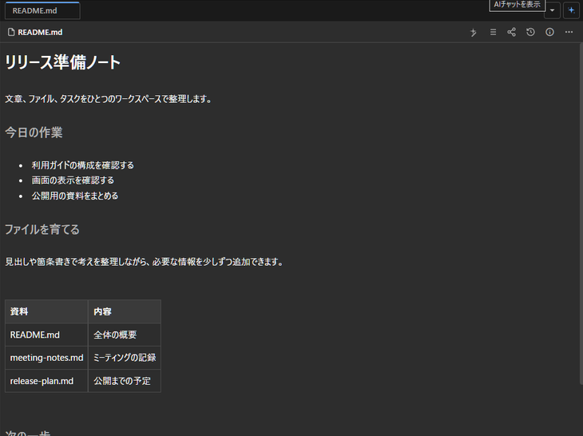
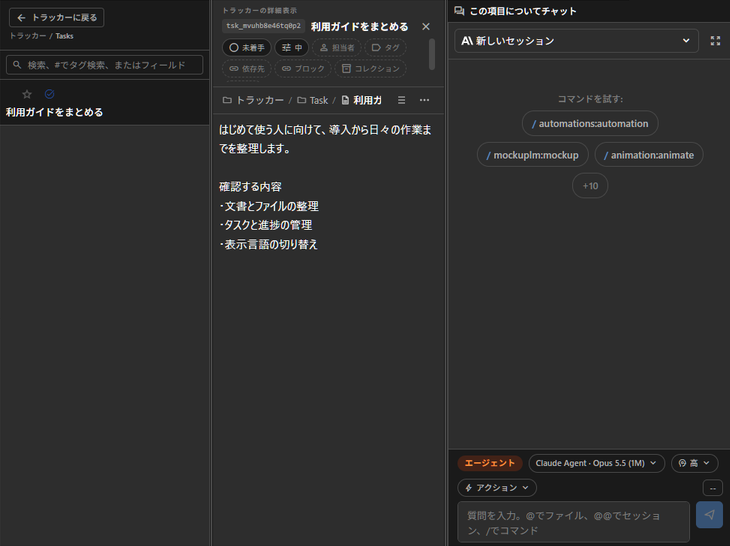
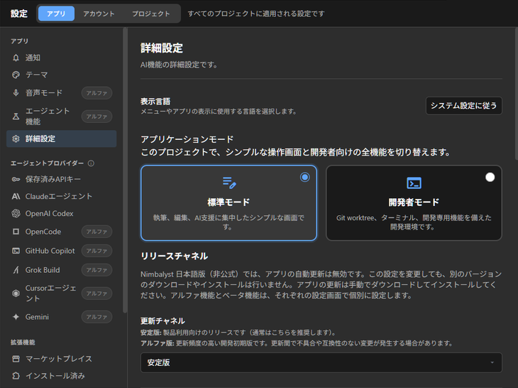

# Nimbalyst 日本語版（非公式）

Nimbalystは、Claude CodeやCodexなど、複数のAIエージェントを一つのアプリから使い分けられる、オープンソースの作業環境です。文章の執筆やアプリ開発に必要なファイル、タスク、進捗状況も、ひとつの画面でまとめて管理できます。

Nimbalystのデスクトップアプリのユーザーインターフェースを日本語化した非公式版です。メニュー、設定、ファイル管理、AIセッション、トラッカー、ダイアログなどに日本語表示を追加しています。表示言語は日本語と英語から選択できます。

本プロジェクトはNimbalyst, Inc.の公式製品ではなく、同社による開発・サポート・承認を受けたものではありません。

[English](README.en.md) · [Windows導入手順](docs/WINDOWS_JA_UNOFFICIAL.md) · [利用ガイド](https://github.com/Meistertech-JP/nimbalyst-ja-unofficial/wiki) · [本家Nimbalyst](https://github.com/nimbalyst/nimbalyst)

## 提供状況

最新版 **v0.82.7-ja.1** は、本家v0.82.7の固定コミット `826adb4f93dbe86db35b76ce2502a3a33abe0489` に基づくWindows x64向けの未署名版です。NSISインストーラー、ポータブルZIP、対応ソースZIP、SHA256SUMS.txtを[対象Release](https://github.com/Meistertech-JP/nimbalyst-ja-unofficial/releases/tag/v0.82.7-ja.1)から取得できます。

配布物に対応するソースはタグ `v0.82.7-ja.1` です。継続的に更新される `main` ではなく、対象ReleaseのタグとソースZIPを使用してください。[旧版v0.82.4-ja.1](https://github.com/Meistertech-JP/nimbalyst-ja-unofficial/releases/tag/v0.82.4-ja.1)を含む過去のタグ・Release・配布物は保持しています。公式最新版とは機能・修正内容が異なる場合があります。

公開品質判定は **GO WITH KNOWN LIMITATIONS（既知制限付き）** です。Windows全体試験の完全成功や、すべての実通信・表示経路の検証完了を意味しません。[既知制限](docs/KNOWN_LIMITATIONS_v0.82.7-ja.1.md)を確認してください。

### 次期候補（未公開）

`v0.82.8-ja.1` は本家v0.82.8への追従候補です。現在、翻訳・互換性・Windows配布物を検証中で、**Releaseはまだ公開されていません**。この候補の配布物はダウンロードできません。公開済みの最新版は引き続きv0.82.7-ja.1です。候補の変更と検証範囲は[候補リリースノート](RELEASE_NOTES_v0.82.8-ja.1.md)および[候補の既知制限](docs/KNOWN_LIMITATIONS_v0.82.8-ja.1.md)を参照してください。

## 日本語の画面

Windows版の実画面です。文書とタスクにはサンプルデータを使用しています。

### 文書の編集



### トラッカーとAIセッション



### 表示言語とアプリケーション設定



## この版の変更

本家v0.82.4からv0.82.7までの変更を取り込み、Lexical 0.53とMarkdownの色付きテキスト、PGLiteからSQLiteへの移行、AIセッション・SDK・履歴読み込み・週次使用量、WindowsのGit・CLI、Trackerのローカル番号などに対応しています。本家Issue #1889由来の修正も統合しています。新しいUIに対応する日本語表示を追加しました。[リリースノート](RELEASE_NOTES_v0.82.7-ja.1.md)で、本家由来の変更と実際に確認した範囲を区別しています。

**チーム復旧には更新された同期サーバーが必要です。** 他の編集クライアントにも対応版が必要です。本番組織の復旧や独立クライアント間の完全な復旧手順は未検証です。既存組織の復旧を試す前に、サーバーの対応状況と復旧対象を確認してください。

## 表示言語とデータ

設定の表示言語でSystem、English、日本語を選択します。エージェントの回答言語とは別の設定です。ユーザー文書や外部サービスの応答を自動翻訳しません。Trackerの一部の名前や状態には英語が残ります。

R24候補の共有翻訳資源は27名前空間、英語・日本語各15,401キーです。キー差・空の日本語翻訳・補間変数の差は0で、Electronネイティブメニュー等にも対応しています。これは候補ソースの静的整合性であり、全画面・全動的参照経路の翻訳完了を保証するものではありません。公開済みv0.82.7-ja.1の資源数は各15,321キーです。

WindowsアプリIDは `jp.meistertech.nimbalyst.ja.unofficial`、既定ユーザーデータは `%APPDATA%\Nimbalyst 日本語版（非公式）` です。公式版の設定を移動・削除しません。公式版との同時利用はサポートしません。本版は `nimbalyst://` の既定ハンドラーを取得せず、認証にはインスタンス固有のnonce付きlocalhost callbackを使用します。認証メールは同じWindows PCで開いてください。

更新は本リポジトリのReleasesから手動で行います。公式版の自動更新と手動更新確認は無効です。アンインストールはユーザーデータを保持する構成です。

## Windows配布と検証範囲

版ごとの実機操作、自動テスト、未検証事項は[検証記録](https://github.com/Meistertech-JP/nimbalyst-ja-unofficial/wiki/Testing-and-Verification)に区別して記載しています。以前のバイナリの成功を、新しい配布物での再実行結果とは扱いません。全画面・全DPI・全認証経路の保証はありません。

配布対象は未署名Windows x64 NSIS、ポータブルZIP、対応するソースZIPとSHA256SUMS.txtです。警告や保護機能を無効にせず、取得元・バージョン・SHA-256を確認してください。ハッシュ一致は電子署名や安全性の保証ではありません。

shell／CLIプロセスの自然終了を繰り返すと、本家・本版とも端末用資源とメモリがアプリ終了まで残る場合があります。各版20回の比較ではMainメモリが約156 MiB増加しました。通常の永続shell内のコマンド1回ごとの増加ではなく、無制限に同じ割合で増えると断定する測定でもありません。増加時は作業を保存し、通常終了して再起動してください。根本修正は未実施です。

R24候補では5,000件の検索結果表示を実画面で確認しましたが、検索あり・該当なしのCPU差は測定上ほぼなく、文書を閉じたアイドル基準も取れていません。大きな文書の高CPU問題は解消と判定していません。高負荷時にはローカルWikiのセッション開始文脈が遅延・省略される可能性も残ります。Windows全体試験はホスト上の同一プロセスloopback停止等により正常完走していません。別プロセスでの主要API試験は両版とも成功しました。Linux単体試験は本版19,754 PASS／0 FAIL／30 SKIPですが、Linux製品の配布・動作保証ではありません。詳細は[候補の日英制限事項](docs/KNOWN_LIMITATIONS_v0.82.8-ja.1.md)を参照してください。

Google認証、特殊な復旧経路、サーバー側のセッション失効、別ユーザーのNTFS実効アクセス、外部スクリーンリーダー、動的翻訳参照の全経路は未検証です。Windowsのsymlink fixture準備でEPERMとなる試験には未検証範囲があり、Linuxでの成功と区別します。[制限事項](https://github.com/Meistertech-JP/nimbalyst-ja-unofficial/wiki/Compatibility-and-Limitations)を参照してください。

共有Trackerの組み込み型を使用する機能には対応する同期サーバーが必要です。旧サーバー・旧クライアントとの互換性は未検証です。また、本版使用後に旧版へ戻すと、保存された外部セッションのカーソル形式を旧版が読み取れない場合があります。ダウングレードと復旧は未検証です。

## ソースからのビルド

Node.js 24以降、リポジトリ指定のpnpm 12.9.1、Windowsネイティブビルドツールを使用します。

```powershell
corepack pnpm install --frozen-lockfile
corepack pnpm --filter @nimbalyst/i18n run build
corepack pnpm run build:workspace-deps
corepack pnpm --filter @nimbalyst/memory-engine run build
corepack pnpm --filter @nimbalyst/tracker-builtins run build
corepack pnpm --filter @nimbalyst/collab-bundle run build
corepack pnpm --filter @nimbalyst/runtime run build
$env:ALLOW_UNSIGNED_WINDOWS_BUILD = 'true'
$env:CSC_IDENTITY_AUTO_DISCOVERY = 'false'
corepack pnpm --dir packages/electron run build:win --publish never
```

完成した `packages/electron/release/win-unpacked` から同じペイロードのZIPを生成できます。

```powershell
corepack pnpm --dir packages/electron exec electron-builder --prepackaged release/win-unpacked --win zip --x64 --publish never
```

生成成功は実起動・認証・更新成功の保証ではありません。未署名ビルドに署名資格情報は不要です。型検査は `corepack pnpm run typecheck` で実行します。

## ライセンス

MIT Licenseです。元の `Copyright (c) 2024-2026 Nimbalyst Inc.` とライセンス本文を保持しています。同梱第三者ソフトウェアには各ライセンスが適用されます。ソース内の `packages/electron/resources/generated` と配布物の `resources/legal` に一覧・NOTICEを同梱します。
